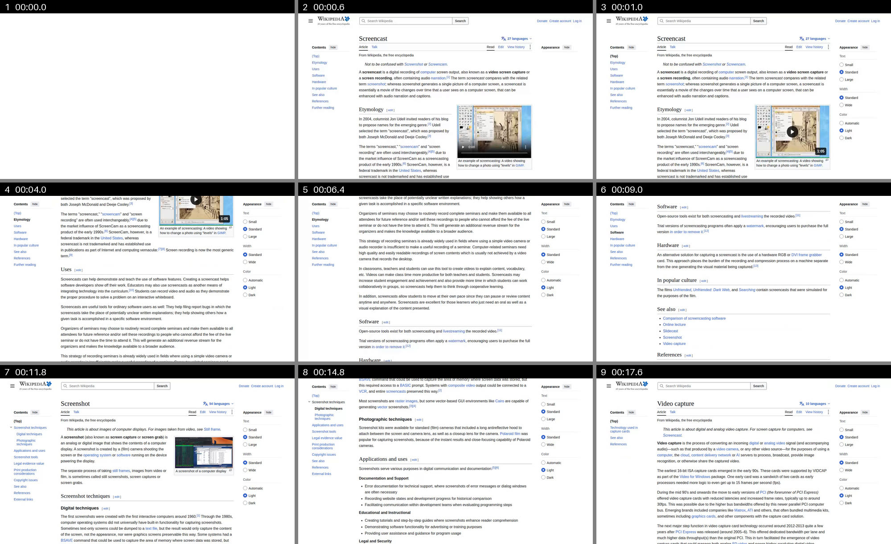

# skimcast

Turn a screen recording into the few timestamped screenshots an AI agent needs
to read it.

Agents cannot watch video, but they read screenshots well. A screen recording
is mostly still, so skimcast keeps only the frames where something happened,
stamps each with its time since the recording started, and lays every nine out
in one overview grid.

```bash
uv tool install git+https://github.com/testy-cool/skimcast
skimcast recording.mp4
```

One run on a 20-second recording of three Wikipedia pages being scrolled (paths
shortened):

```
00:00.0  wikipedia-demo_skimcast/001_00m00.0s.png  (start of recording)
00:00.6  wikipedia-demo_skimcast/002_00m00.6s.png  (16.2% of the screen changed)
00:01.0  wikipedia-demo_skimcast/003_00m01.0s.png  (3.6% of the screen changed)
00:04.0  wikipedia-demo_skimcast/004_00m04.0s.png  (26.5% of the screen changed)
00:06.4  wikipedia-demo_skimcast/005_00m06.4s.png  (21.8% of the screen changed)
00:09.0  wikipedia-demo_skimcast/006_00m09.0s.png  (15.8% of the screen changed)
00:11.8  wikipedia-demo_skimcast/007_00m11.8s.png  (17.7% of the screen changed)
00:14.8  wikipedia-demo_skimcast/008_00m14.8s.png  (22.8% of the screen changed)
00:17.6  wikipedia-demo_skimcast/009_00m17.6s.png  (20.9% of the screen changed)
overview  wikipedia-demo_skimcast/grid_01_001-009.png

9 screenshots and 1 overview grid from 00:20.3 of video. Index: wikipedia-demo_skimcast/index.md
Report for people: wikipedia-demo_skimcast/report.html
```

The overview grid from that run:



## What you get

Everything goes to `<video>_skimcast/` next to the video, or to `--out DIR`.

- `001_00m00.0s.png` and on: full-size screenshots with a black band on top
  that says how far into the recording each was taken. When only a little
  changed since the screenshot before, a magenta box marks it.
- `grid_01_001-009.png` and on: nine consecutive screenshots in a 3x3 grid,
  2000 px wide, each labelled with its number and time. The last grid leaves
  its unused slots empty.
- `index.md`: the list of screenshots and why each was kept, written for the
  agent to read first.
- `report.html`: a page for you, to check what the agent was given. It shows
  every moment skimcast looked at on a timeline (how much the screen changed,
  when the mouse moved), which moments it kept, and a log of each decision,
  including mouse stops it chose not to keep and why.

An agent can read the grids to see the whole recording, then open single
screenshots where it needs to read text.

## How it picks frames

- The screen changed (by default at least 0.1% of it) and then stopped
  changing. A page that loads or scrolls is caught once it settles.
- During non-stop change, such as a playing video, one frame every 2 seconds.
- Moving the mouse is not a change. When the mouse travels somewhere and stops
  for 1.5 seconds, that moment is kept, because a resting mouse usually points
  at something. Changes in the top and bottom 4% of the screen, where panel
  clocks and tray icons live, do not count as mouse movement.
- When less than 2% of the screen changed since the screenshot before, a
  magenta box goes around each changed area, because a small change is easy
  to miss, especially in a grid. Bigger changes are not boxed, since they are
  plain to see and boxes would be noise. Neither are the cursor, thin slivers
  such as a title bar changing shade, or changes scattered over more than five
  places.
- When there are more than `--max` frames (default 40), the ones most like the
  frame before them are dropped first.

## Options

```
skimcast VIDEO [--out DIR] [--min-change PCT] [--max N]
```

- `--min-change 0.03` catches smaller changes, such as a few typed letters.
- `--max 20` keeps fewer screenshots.

## Use it from an agent

`SKILL.md` in this repository is a skill for Claude Code and other agents that
read skills. Copy it to `~/.claude/skills/skimcast/SKILL.md`, then give the
agent a video path and ask what happened in it.

## Requirements and limits

- Needs `ffmpeg` and `ffprobe` on your PATH, and [uv](https://docs.astral.sh/uv/)
  to install. Without installing, `uv run skimcast.py VIDEO` also works.
- Built and tested on Linux with ffmpeg 6.1. Not yet tried on macOS or Windows.
- Sound is not transcribed. `index.md` says when a video has a sound track.
- The grid is 2000 px wide because that is the widest image Claude Code showed
  the model without shrinking it, in our test. Other models may shrink it more.
- Mouse rests are only found when the recorder draws the cursor into the video,
  as most screen recorders do.

## License

MIT
